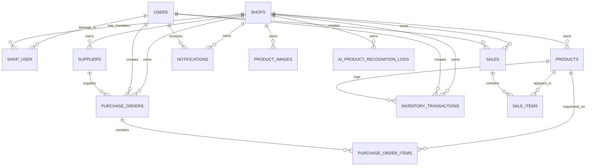

# Database ERD plan

Key constraints:

- `products` uses `unique(shop_id, barcode)` when barcode is enabled.
- `shop_user` uses a composite unique constraint on `(shop_id, user_id)`.
- `inventory_transactions` is append-only, never updated once created.
- Sales and purchase orders are transactional and can be audited.
